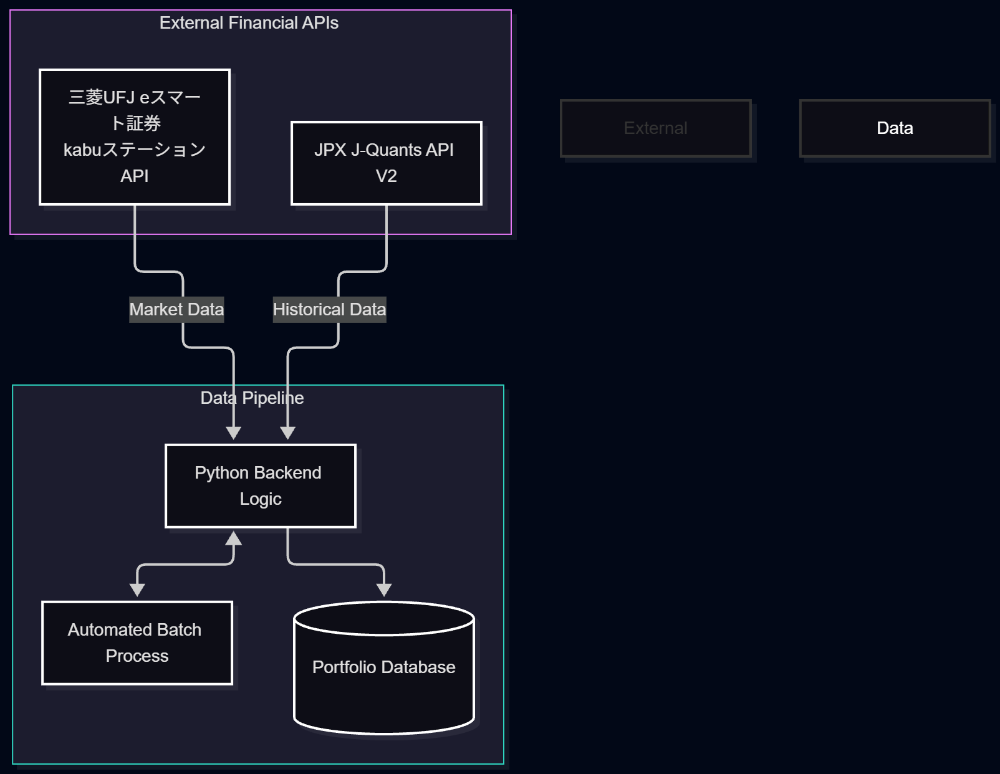

# 松岡 夏輝 (Natsuki Matsuoka)
**System Engineer / Cloud & Enterprise Architect**

「ビジネス課題の解決」を起点とし、フロントエンドのUI/UX設計から、エンタープライズシステム（Salesforce等）とクラウド（AWS）の統合、複雑なバックエンドAPI連携まで、目的に応じて最適なアーキテクチャを設計・実装するフルスタックな開発アプローチを強みとしています。

## 🛠 Tech Stack & Expertise
- **Cloud / Backend:** AWS (Lambda, API Gateway, DynamoDB, Cognito), Cloudflare, Podman, Docker
- **Enterprise / CRM:** Salesforce (Apex, LWC, OmniStudio, Integration)
- **Frontend / UI:** React, SPA, Japandi Design principles
- **Language / Data:** Python, FastAPI, SQL (PostgreSQL)

---

## 🚀 Projects Portfolio
特定の技術スタックに依存するのではなく、それぞれ全く異なるビジネス要件とアーキテクチャ（完全サーバーレス / オンプレ・ハイブリッド / データ処理）を採用した3つの主要プロジェクトをご紹介します。

### 1. FitTracker 
**【モダンWeb × 完全サーバーレス構築】**
健康管理を習慣化するための、UI/UXにこだわったモダンSPAアプリケーション。

- **Architecture:** `完全AWSサーバーレス構成`
- **Tech Stack:** React, Cloudflare Pages, AWS Lambda, DynamoDB, Amazon Cognito
- **技術選定と設計のポイント:**
  - 保守性とスケーラビリティを最大化するため、インフラ管理が不要な完全サーバーレスアーキテクチャを採用。
  - セキュリティを担保するためCognitoを用いたゼロトラストな認証基盤を構築。
  - 毎日使うツールとしての体験価値を高めるため、フロントエンドは「和モダン（Japandi）」を取り入れたUI/UX設計を実践。
- **Status:** 開発完了・運用中（または 〇〇フェーズ実装中）

### 2. 物流倉庫の設備保守・部品在庫管理DXシステム
**【エンタープライズ × ハイブリッド連携（SI統合）】**
既存の業務基幹システム（Salesforce）と、閉域網のローカル環境をセキュアに統合するエンタープライズ向けハイブリッドシステム。

- **Architecture:** `パブリッククラウド × ローカルコンテナ ハイブリッド構成`
- **Tech Stack:** Salesforce, AWS API Gateway, AWS Lambda, Cloudflare Tunnels, Podman (PostgreSQL / FastAPI)
- **技術選定と設計のポイント:**
  - 基幹業務のコアであるSalesforceをフロントとしつつ、ローカル(オンプレミス)で稼働するDBへの安全なアクセス経路としてCloudflare Tunnelsを採用。
  - AWS API GatewayとLambdaを中継ハブとして配置することで、既存エンタープライズシステムとモダンなコンテナ環境（Podman/FastAPI）をシームレスかつセキュアに統合。
  - 将来的なクラウド移行（フルAWS化等）も視野に入れた、段階的なモダナイゼーションのベストプラクティスとして設計。
- **Status:** 🚧 **開発進行中** (要件定義・基本設計完了。現在、ローカルPodman環境でのPostgreSQLおよびFastAPIモックを実装中)

### 3. 東証ETF・AI投資ポートフォリオシステム
**【データ処理 × バックエンドAPI連携】**
複雑な外部金融APIを統合し、自動でデータを収集・処理するデータドリブンなバックエンドシステム。

- **Architecture:** `データパイプライン × APIオーケストレーション`
- **Tech Stack:** Python, kabuステーションAPI (三菱UFJ eスマート証券), J-Quants API V2
- **技術選定と設計のポイント:**
  - 厳密な仕様が求められる複数の外部金融APIを連携・統合するための、堅牢なバックエンドロジックをPythonで構築。
  - リアルタイム性の高いデータ取得と、バッチ処理によるポートフォリオ分析を両立させるためのデータパイプライン設計。
  - 単なるWeb開発にとどまらない、データ処理と自動化に特化したスクリプトおよびアーキテクチャの実現。
- **Status:** 🚧 **開発進行中** (API連携テストおよび基礎データ収集フェーズ)

---

## 📈 Career & Goals
現在、IBMデジタルサービスにて航空業界向けSalesforceのエンタープライズAMS（運用・保守・改修）チームのリーダーとして従事しています。
今後は、これまでの「製造現場での実務経験」「エンタープライズシステムの保守・運用」「モダン技術を用いたプライベート開発」の点と点を繋ぎ、**ビジネス要件のヒアリングから技術選定、アーキテクチャ設計までをリードできるポジション**を目指しています。

- 📫 **Contact / Links:** [LinkedIn / Twitter / Portfolio URL 等]
