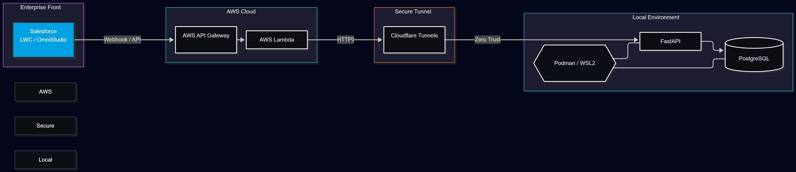
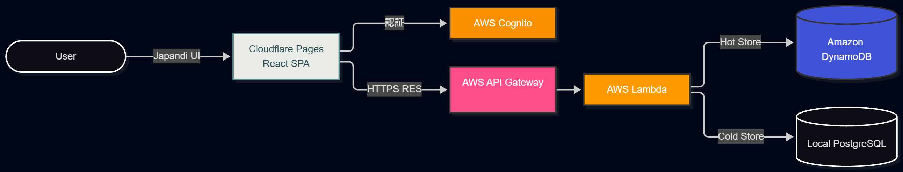

# 松岡 夏輝 (Natsuki Matsuoka)

「ビジネス課題をシステムで解決する」を軸にエンタープライズシステムの保守・運用から、モダンなクラウドネイティブ開発までを一気通貫で推進するエンジニアを目指しています。

## Summary & Vision
現在のIBMデジタルサービス株式会社では、チームリーダーとして航空業界向けSalesforceのエンタープライズAMSで顧客折衝・要件定義・運用保守を牽引しています。
エンジニアとして私は**「自身のスキルギャップを自覚し、自ら手を動かしてキャッチアップする行動力」**があります。

- **課題認識からの圧倒的なキャッチアップ（クラウド領域への挑戦）:**
  これまでの個人開発は、Pythonによるデータ処理（ETF・AI投資システム）やオンプレミス環境を用いたNASやIoTが中心でした。
  そのため、「クラウド（AWS等）の実装経験・アーキテクチャ設計力が不足している」と痛感しました。
  このギャップを埋めるため、直近で新たに**「完全AWSサーバーレス構成（FitTracker）」**および**「Salesforce×AWS×ローカル環境のハイブリッド構成（物流DXシステム）」**の2つのプロジェクトを自ら企画し、実装を推進しています。
- **AI駆動開発（AI-Driven Development）の実践:**
  短期間でのクラウド技術の習得と実装を可能にしているのが、ClaudeやGemini、CodexなどのAIツールの活用です。未知のAWSサービス（API GatewayやCognito等）やネットワーク要件（Cloudflare Tunnels等）であっても、AIを壁打ち相手として駆使し、公式ドキュメントと照らし合わせながらインフラ構築からバックエンド・フロントエンドまでを一人で組み上げるモダンな開発手法を実践しています。
- **泥臭い技術探求とHome Lab:**
  机上の空論ではなく、自宅のProxmox VEサーバー上にローカル検証環境（Podman/Docker）を構築し、セキュアなトンネル接続の検証など、業務外でも日々泥臭く技術に触れる環境を作っています。

**【KDDIアイレットでの目標とコミットメント】**
現時点でのクラウドネイティブな実務経験の不足は自覚しておりますが、「不足を認識し、最新技術を駆使して自ら手を動かしカバーする学習」で入社した後も全力でキャッチアップするつもりです。
まずはWebアプリエンジニアとしていち早くクラウド環境でのSI開発経験を積み上げ、事業に貢献しながら、将来的にはエンタープライズとクラウドを統合するプロジェクトリーダー（PL）へとステップアップしていきたいと考えています。

---

## 🛠 Tech Stack & Expertise
- **Cloud / Backend:** AWS (Lambda, API Gateway, DynamoDB, Cognito), Cloudflare, Podman, Docker
- **Enterprise / CRM:** Salesforce (Apex, LWC, OmniStudio, Integration)
- **Frontend / UI:** React, SPA, Japandi Design principles
- **Language / Data:** Python, FastAPI, SQL (PostgreSQL)

---

## Projects Portfolio
クラウド経験の不足を最速で埋めるため、あえて異なるビジネス要件とアーキテクチャを採用して並行推進している2つの主要プロジェクトをご紹介します。

### 1. 物流倉庫の設備保守・部品在庫管理DXシステム
**【エンタープライズ × ハイブリッド連携（SI統合）】**
既存の業務基幹システム（Salesforce）と、閉域網のローカル環境をセキュアに統合するエンタープライズ向けハイブリッドシステム。

- **Status:** **開発進行中**（インフラ・バックエンド基盤構築完了、SFDC連携フェーズへ移行）
- **Repository:** [Team-Matsuoka-Haishi/warehouse-infra-backend](https://github.com/Team-Matsuoka-Haishi/warehouse-infra-backend) 
  *(※チーム開発体制(2名)で進行中。AWS・ローカル間の基本設計書・詳細設計書・手順書等のドキュメント類もリポジトリ内で管理しています)*
- **Architecture:** `パブリッククラウド × ローカルコンテナ ハイブリッド構成`
- **Tech Stack:** Salesforce, AWS API Gateway, AWS Lambda, Cloudflare Tunnels, Podman (PostgreSQL / FastAPI)
- **技術選定と設計のポイント:**
  - 基幹業務のコアであるSalesforceをフロントとしつつ、ローカル(オンプレミス)で稼働するDBへの安全なアクセス経路としてCloudflare Tunnelsを採用。
  - AWS API GatewayとLambdaを中継ハブとして配置することで、既存エンタープライズシステムとモダンなコンテナ環境（Podman/FastAPI）をシームレスかつセキュアに統合。
  - 将来的なクラウド移行（フルAWS化等）も視野に入れた、段階的なモダナイゼーションのベストプラクティスとして設計。

### 2. FitTracker 
**【モダンWeb × 完全サーバーレス構築】**
健康管理を習慣化するための、UI/UXにこだわったモダンSPAアプリケーション。

- **Status:** **実装済・公開中**
- **Repository:** [Matsun25/Matsuoka-Fit-Tracker](https://github.com/Matsun25/Matsuoka-Fit-Tracker)
  *(※本リポジトリは、ローカル環境で開発・運用中のプロジェクトをポートフォリオ用に公開したものです)*
- **Architecture:** `完全AWSサーバーレス構成`
- **Tech Stack:** React, Cloudflare Pages, AWS Lambda, DynamoDB, Amazon Cognito
- **技術選定と設計のポイント:**
  - 保守性とスケーラビリティを最大化するため、インフラ管理が不要な完全サーバーレスアーキテクチャを採用。
  - セキュリティを担保するためCognitoを用いたゼロトラストな認証基盤を構築。
  - 毎日使うツールとしての体験価値を高めるため、フロントエンドは「和モダン（Japandi）」を取り入れたUI/UX設計を実践。

---

## Career & Goals
現在、IBMデジタルサービスにて航空業界向けSalesforceのエンタープライズAMS（運用・保守・改修）チームのリーダーとして従事しています。
今後は、これまでの「製造現場での実務経験」「エンタープライズシステムの保守・運用」「モダン技術を用いた個人開発」の点と点を繋ぎ、**上流から参画してビジネス要件のヒアリングから技術選定、アーキテクチャ設計までをリードできるポジション**を目指しています。
